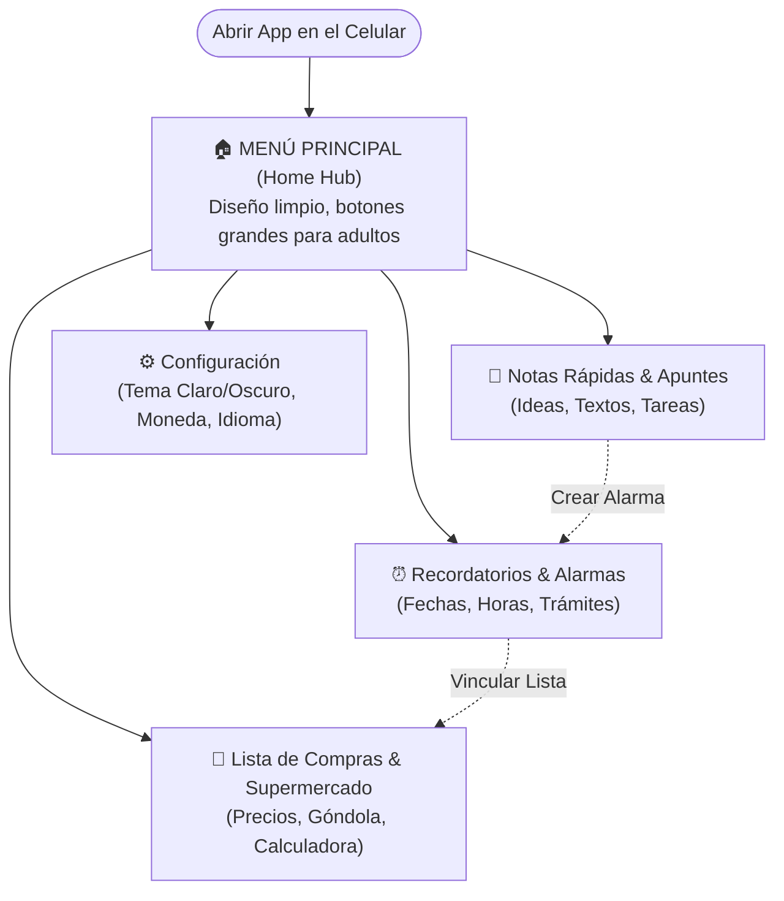
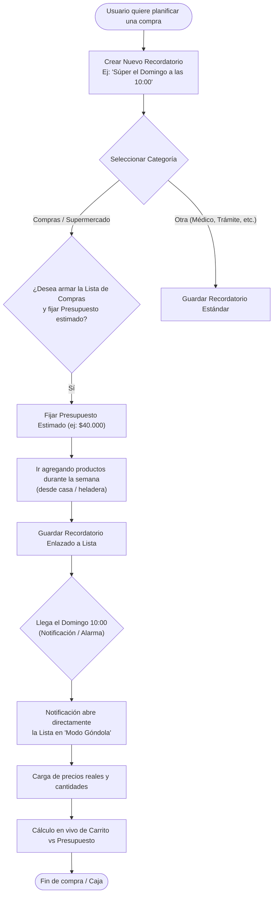
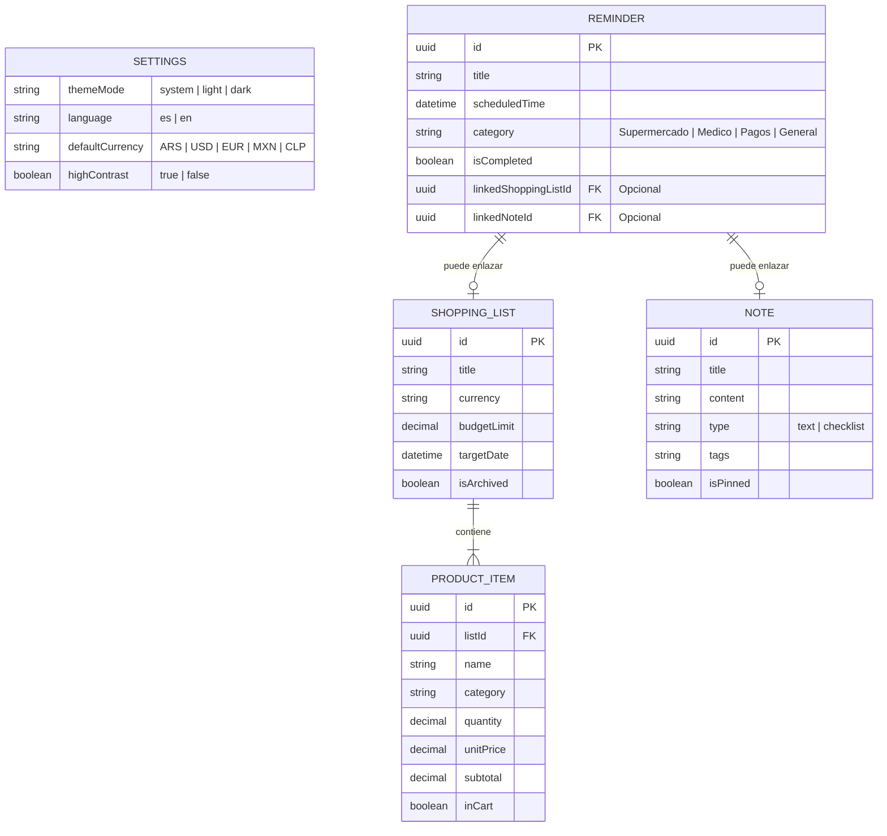

# Especificación de Requisitos de Software (SRS / PRD)
**Nombre Oficial del Proyecto:** Anotado  
**Identidad Visual / Isotipo:** Check verde estilizado (✓) sobre fondo limpio  
**Slogan / Descriptor:** "Anotado: Notas, Recordatorios y Súper"  
**Versión:** 1.3 (Branding Oficial "Anotado", Menú Principal, Temas Claro/Oscuro/Sistema, Reminders Enlazables)  
**Fecha:** 22 de noviembre de 2026  

---

## 1. Visión y Principios del Producto

### 1.1. Propósito y Perfil de Usuario
Aplicación móvil ligera (PWA), 100% *Offline-First*, diseñada con foco especial en la **facilidad de uso para público adulto / personas que buscan practicidad sin complicaciones**:
* **Interfaz Limpia y Despejada:** Fuentes grandes y legibles (mínimo 16-18px), botones táctiles amplios (mínimo 48-52px de alto), contrastes nítidos.
* **Menú Principal Directo (Home Hub):** Al abrir la app, el usuario no se pierde en pantallas confusas: ve de inmediato las 3 acciones principales claramente identificadas con iconos y textos en lenguaje cotidiano.
* **Flujo Natural de Compras:** Posibilidad de crear un recordatorio anticipado (ej. *"Ir al súper el domingo con presupuesto de $40.000"*), ir agregando productos durante la semana, y al llegar al supermercado abrir la lista directamente para ir sumando los precios reales mientras compra.

### 1.2. Principios Arquitectónicos
1. **Módulos Desacoplados pero Enlazables (Smart Linking):** Recordatorios y Notas son entidades completamente independientes, pero un Recordatorio con categoría *"Compras / Supermercado"* puede enlazar y dar origen a una Lista de Compras con presupuesto asignado.
2. **Motor de Personalización de Temas:**
   * Detección automática del tema del sistema (`prefers-color-scheme`).
   * Selector manual del usuario: **Sistema (Automático)** | **Modo Claro (Light)** | **Modo Oscuro (Dark)**.
3. **Internacionalización (i18n) & Multimoneda:** Bilingüe (Español / Inglés) y soporte para divisas globales y regionales (`CLP`, `USD`, `EUR`, `ARS`, `MXN`).
4. **Local-First (Offline Real) sin dependencias externas:** Toda la información se guarda en IndexedDB nativo (`js/core/db.js`) con respaldo/importación JSON, usando JavaScript modular ES6 sin build step. Para alarmas con la app cerrada, los recordatorios se exportan como eventos `.ics` al calendario nativo del dispositivo.

---

## 2. Diagramas de Flujos y Arquitectura (Mermaid)

### 2.1. Navegación Principal desde el Home Hub (Menú Principal)

---

### 2.2. Flujo Integrado: Recordatorio de Compras con Presupuesto ➡️ Modo Góndola

---

### 2.3. Diagrama de Relación de Datos (ERD Modular y Desacoplado)

---

## 3. Especificación Detallada de Módulos (Scopes de Depuración)

### 🔹 MÓDULO 0: Core Engine (Temas, i18n, Monedas & Persistencia)
* **Gestor de Temas (Theme Engine):**
  * Modos soportados:
    1. `system`: Escucha `window.matchMedia('(prefers-color-scheme: dark)')` y aplica la clase `.dark` reactivamente.
    2. `light`: Forzado de fondo blanco/marfil (`#F8FAFC` o `#FFFFFF`) con texto negro azabache de máximo contraste (`#0F172A`).
    3. `dark`: Fondo carbón profundo (`#090D16` o `#1E293B`) con texto blanco brillante para evitar fatiga visual nocturna.
* **i18n & Multimoneda:**
  * Diccionarios completos ES / EN.
  * Formateo nativo de monedas con símbolos y separadores regionales (`ARS`, `USD`, `EUR`, `MXN`, `CLP`).
* **Storage Engine:** Base de datos IndexedDB nativa (`js/core/db.js`) con tablas `settings`, `reminders`, `shopping_lists`, `products`, `notes` y `price_history`.

---

### 🔹 MÓDULO 1: Menú Principal (Home Hub) & Experiencia Adulta
* **Pantalla de Inicio Despejada (Dashboard):**
  * Tres accesos principales en tarjetas de gran tamaño con colores diferenciados:
    * 🟢 **Ir al Supermercado / Compras:** Con badge si hay una compra en curso o pendiente.
    * 🔵 **Mis Recordatorios:** Con vista previa de la próxima alarma programada.
    * 🟡 **Mis Notas y Apuntes:** Con contador de notas rápidas.
  * Botón accesible en esquina superior para **Configuración** (Temas, Moneda, Idioma).
* **Parámetros de Accesibilidad para Adultos:**
  * Tamaños mínimos de tipografía: Títulos 20-24px, Botones 16-18px, Textos secundarios 14px.
  * Espaciado amplio entre botones para evitar toques accidentales (*fat-finger friendly*).

---

### 🔹 MÓDULO 2: Recordatorios Independientes & Enlace Inteligente a Compras
* **Creación de Recordatorio:**
  * Campos: Título, Fecha y Hora, Categoría con selector visual:
    * 🛒 *Supermercado / Compras*
    * 🏥 *Salud / Médico*
    * 💳 *Pagos / Servicios*
    * 📌 *General / Personal*
* **Lógica de Enlace a Compras (Smart Link):**
  * Si selecciona *Supermercado / Compras*, la interfaz despliega una opción:
    > *"¿Deseas armar la lista de compras y definir un presupuesto estimado?"*
  * Al activarlo, permite ingresar el **Presupuesto Límite** (ej: `$ 40.000`) y crea de forma automática una `ShoppingList` vinculada.
  * Al llegar el día y hora del recordatorio, la notificación del celular incluye una acción directa: **"Abrir Lista de Compras"**, llevando al usuario directo al "Modo Góndola".

---

### 🔹 MÓDULO 3: Notas Rápidas & Apuntes (Desacoplado)
* **Entidad Independiente de Notas:**
  * No exige fecha ni hora de vencimiento obligatoria.
  * Formato de texto simple o lista de tareas con casillas de verificación.
  * Opción de enlazar a un recordatorio si el usuario luego decide que una nota debe avisarle en un momento específico.

---

### 🔹 MÓDULO 4: Supermercado & Calculadora Inteligente en Góndola
* **Cálculo de Precios en Vivo:**
  * Ingreso ágil de precio unitario $\times$ cantidad = subtotal automático.
  * Checkbox grande para marcar productos ya cargados al carro.
  * **Barra de Totales Flotante:**
    * *En el Carro (Confirmado):* Lo que llevas en el carro hasta el momento.
    * *Total Proyectado:* Todo lo planificado.
    * *Estado del Presupuesto:*
      * Si está dentro del presupuesto: Indicador verde (ej. *"Tienes $ 8.500 disponibles"*).
      * Si supera el límite: Alerta en rojo con texto claro (ej. *"Atención: Has superado el presupuesto por $ 3.200"*).
* **Cierre de Compra y Transferencia entre Dispositivos:**
  * Al terminar, permite archivar la lista y guardar los precios unitarios en el catálogo histórico.
  * Desde **"Mis Listas de Compras"**, cada lista se puede **Escanear por QR offline**, **Enviar por enlace comprimido (`deflate-raw`, `#import/z_...`)** o **Exportar como archivo (`.anotado.json`)**, e **Importar** en cualquier otro dispositivo sin servidor.

---

## 4. Matriz de Entrega y Depuración Modular (Testing Gates)

1. **Gate 0 (Core & Temas):**
   - [ ] Switch entre tema Claro, Oscuro y Sistema cambia los colores instantáneamente.
   - [ ] Persistencia de idioma y moneda en IndexedDB.
2. **Gate 1 (Home Hub & Navegación):**
   - [ ] Navegación fluida desde el Menú Principal a cada una de las 3 áreas.
   - [ ] Botones accesibles probados en pantallas táctiles pequeñas y grandes.
3. **Gate 2 (Recordatorios & Enlace):**
   - [ ] Crear recordatorio común (ej. Médico) y verificar disparo de alerta.
   - [ ] Crear recordatorio de Supermercado con presupuesto y comprobar que crea y enlaza la lista de compras.
4. **Gate 3 (Supermercado & Calculadora en Góndola):**
   - [ ] Cálculos en vivo de subtotales, totales y comparativa contra el presupuesto asignado.
   - [ ] Marcar ítems en el carro y verificar actualización del acumulado.
5. **Gate 4 (Notas Rápidas):**
   - [ ] CRUD de notas independientes y opción de vincular a recordatorio.
