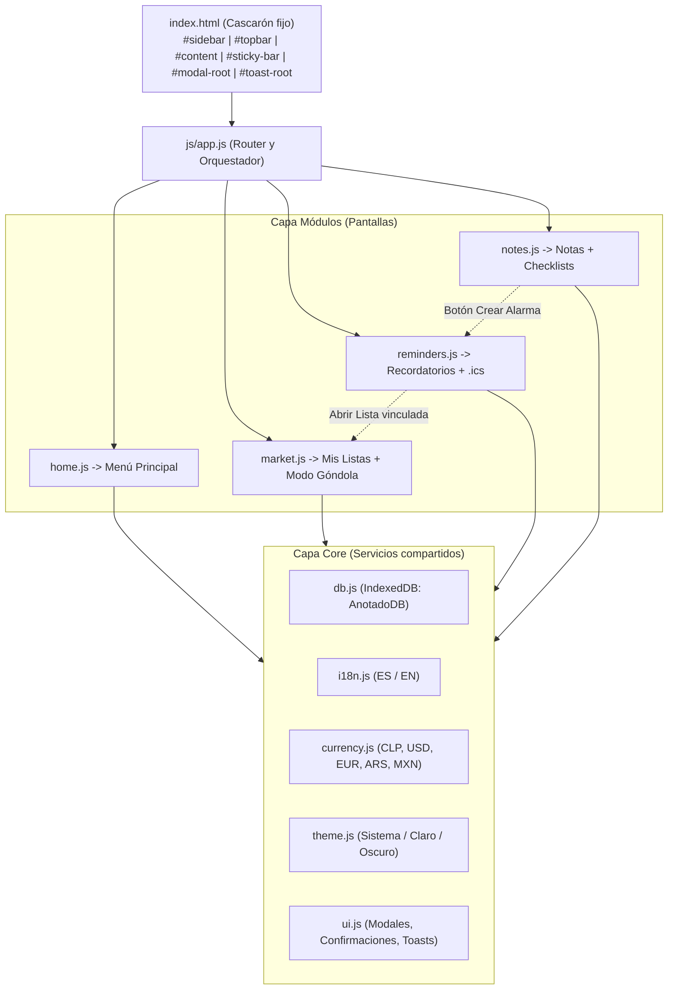

# Diccionario de Arquitectura y Etiquetas UI — Anotado

Este documento mapea la estructura de archivos, el flujo entre módulos y las etiquetas exactas (`#id` y `[data-*]`) de cada pantalla, botón, sección y modal de la aplicación. Sirve como referencia directa para solicitar cambios precisos sin ambigüedades.

---

## 1. Diagrama de Arquitectura

---

## 2. Marco Global (`index.html` + `js/app.js`)

| Etiqueta / ID | Tipo | Ubicación y función |
| :--- | :--- | :--- |
| `#sidebar` | Sección | Barra lateral izquierda (solo Tablet/PC $\ge 768\text{px}$). |
| `[data-side-nav]` | Botones | Navegación lateral: `home`, `market`, `reminders`, `notes`. |
| `#side-settings-btn` | Botón | Abre el modal de Configuración desde `#sidebar`. |
| `#topbar` | Sección | Barra superior fija en todas las pantallas. |
| `#top-back-btn` | Botón | `◀ Menú` (solo móvil, visible fuera de Home; vuelve a `home`). |
| `#topbar-list-select` | Selector | Desplegable centrado en `#topbar` (solo visible dentro de una lista activa) para cambiar de lista. |
| `#top-theme-btn` | Botón | Alterna rápido entre tema Claro (`☀️`) y Oscuro (`🌙`). |
| `#top-settings-btn` | Botón | `⚙️` Abre el modal de Configuración. |
| `#content` | Sección | Área central donde se dibuja la pantalla activa. |
| `#sticky-bar` | Sección | Barra inferior fija (solo visible dentro de una lista activa; muestra totales y presupuesto). |
| `#modal-root` | Sección | Contenedor flotante para formularios y confirmaciones (`#modal-close-btn` cierra). |
| `#toast-root` | Sección | Avisos temporales arriba (`.toast`) con botón opcional (`.toast-action`: Deshacer / Actualizar). |

---

## 3. Pantalla 1: Menú Principal (`js/modules/home.js`)

| Etiqueta / ID | Tipo | Función |
| :--- | :--- | :--- |
| `[data-nav="market"]` | Tarjeta botón | **"Ir al Supermercado"** ➔ abre el Administrador de Listas (`renderListsManager`). |
| `[data-nav="reminders"]` | Tarjeta botón | **"Mis Recordatorios"** ➔ abre Recordatorios. |
| `[data-nav="notes"]` | Tarjeta botón | **"Notas y Apuntes"** ➔ abre Notas. |

---

## 4. Pantalla 2A: Administrador de Listas (`js/modules/market.js` — `renderListsManager`)

| Etiqueta / ID | Tipo | Función |
| :--- | :--- | :--- |
| `#btn-mgr-new-list` | Botón | **"+ Nueva Lista"** (abre `#list-form` y al guardar entra directo a esa lista). |
| `[data-open-market-list]` | Botón | **"Abrir Lista ➔"** en cada tarjeta (entra al Modo Góndola de esa lista). |
| `[data-edit-market-list]` | Botón | **"✏️ Editar"** en cada tarjeta (abre `#list-form` con sus datos). |
| `[data-del-market-list]` | Botón | **"🗑️ Eliminar"** en cada tarjeta (pide confirmación y borra la lista y sus productos). |

---

## 5. Pantalla 2B: Lista Activa / Modo Góndola (`js/modules/market.js` — `renderMarket`)

### Barra de acciones (`.toolbar`)
| Etiqueta / ID | Tipo | Función |
| :--- | :--- | :--- |
| `#btn-add-product` | Botón | **"+ Agregar Producto"** (primera opción; abre `#product-form`). |
| `#btn-archive-list` | Botón | **"✓ Finalizar compra"** / **"↩️ Reabrir lista"**. |
| `#btn-share-list` | Botón | **"💬 Compartir"** (copia o comparte texto formateado). |

### Filtros (`.chip-row`)
| Etiqueta / ID | Tipo | Función |
| :--- | :--- | :--- |
| `[data-cat="ALL"]` | Chip | Muestra todos los productos de la lista. |
| `[data-cat="<Categoría>"]` | Chips | Filtra los productos por rubro (`Abarrotes`, `Lácteos`, etc.). |

### Fila de producto (`.product-row`)
| Etiqueta / ID | Tipo | Función |
| :--- | :--- | :--- |
| `[data-toggle-cart]` | Botón circular | Círculo `✓` izquierdo (marca/desmarca "En el Carro" y recalcula `#sticky-bar`). |
| `[data-edit-prod]` | Área clicable | Nombre, cantidad y rubro (al tocar o pulsar Enter/Espacio abre `#product-form` para editar). |
| `[data-qty-minus]` | Botón | `-` Resta cantidad según unidad (`un`, `kg`, `g`, `L`). |
| `[data-qty-plus]` | Botón | `+` Suma cantidad según unidad (`un`, `kg`, `g`, `L`). |
| `[data-del-prod]` | Botón | `✕` Elimina el producto con toast **"Deshacer"** (5 seg). |

### Modales de Supermercado
* **Modal Lista (`#list-form`):** `#list-title`, `#list-currency`, `#list-budget`, `#list-cancel`.
* **Modal Producto (`#product-form`):** `#prod-name`, `#price-suggestion-box` (`#apply-suggested-price`), `#prod-cat`, `#prod-qty`, `#prod-unit`, `#prod-price`, `#prod-live-sub`, `#prod-cancel`.

---

## 6. Pantalla 3: Recordatorios (`js/modules/reminders.js`)

| Etiqueta / ID | Tipo | Función |
| :--- | :--- | :--- |
| `#btn-new-reminder` | Botón | **"+ Nuevo Recordatorio"** (abre `#reminder-form`). |
| `[data-open-list]` | Botón | **"Abrir Lista ➔"** (solo visible si tiene lista de compras vinculada). |
| `[data-toggle-done]` | Botón | **"Listo"** / **"Completado"**. |
| `[data-ics-rem]` | Botón | **"📅 Calendario (.ics)"** (descarga evento para alarma nativa con la app cerrada). |
| `[data-edit-rem]` | Botón | **"✏️ Editar"** (abre `#reminder-form`). |
| `[data-del-rem]` | Botón | **"🗑️ Eliminar"** (pide confirmación y limpia enlaces en notas). |

* **Modal Recordatorio (`#reminder-form`):** `#rem-title`, `#rem-datetime`, `#rem-cat`, `#smart-link-section` (visible solo en categoría Compras), `#rem-link-list`, `#rem-budget-wrap` (`#rem-budget`), `#rem-cancel`.

---

## 7. Pantalla 4: Notas (`js/modules/notes.js`)

| Etiqueta / ID | Tipo | Función |
| :--- | :--- | :--- |
| `#btn-new-note` | Botón | **"+ Nueva Nota"** (abre `#note-form`). |
| `#notes-search` | Input | Buscador en memoria con *debounce* (filtra por título, texto, etiqueta e ítems de checklist). |
| `#notes-list-container` | Sección | Contenedor de las tarjetas de notas filtradas. |
| `[data-alarm-note]` | Botón | **"🔔 Crear Alarma"** (abre `#reminder-form` prellenado y enlazado). |
| `[data-check-note]` | Checkbox | Casillas interactivas en notas tipo checklist. |
| `[data-edit-note]` | Botón | **"✏️ Editar"** (abre `#note-form`). |
| `[data-del-note]` | Botón | **"🗑️ Eliminar"** (pide confirmación). |

* **Modal Nota (`#note-form`):** `#note-title`, `#note-type` (`text` / `checklist`), `#note-tag`, `#note-content`, `#note-pin`, `#note-cancel`.

---

## 8. Modal de Configuración (`js/app.js`)

| Etiqueta / ID | Tipo | Función |
| :--- | :--- | :--- |
| `#set-theme` | Selector | Tema (`system`, `light`, `dark`). |
| `#set-lang` | Selector | Idioma (`es`, `en`). |
| `#set-curr` | Selector | Moneda principal (`CLP`, `USD`, `EUR`, `ARS`, `MXN`). |
| `#btn-req-notif` | Botón | Solicita permiso de notificaciones al navegador. |
| `#btn-export-backup` | Botón | Descarga respaldo completo de IndexedDB en JSON. |
| `#btn-import-backup` | Botón | Dispara `#input-import-file` para restaurar un respaldo JSON. |
| `#set-done` | Botón | Cierra el modal de configuración. |
